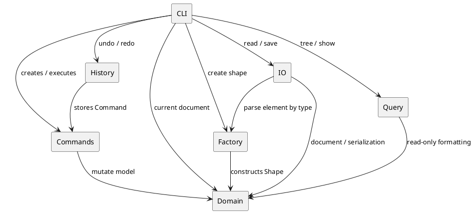

# SVG 编辑器 CLI：架构与完成记录

## 架构方案

### 模块划分

| 模块 | 目录 | 职责 |
|---|---|---|
| CLI | `src/cli` | REPL、tokenize、参数检查、命令注册及应用级编排 |
| Commands | `src/commands` | 将每次可撤销编辑封装为独立 Command；保存撤销所需状态 |
| History | `src/history` | 管理 undo/redo 栈、历史分支和 I/O 历史边界 |
| Domain | `src/domain` | Document、Shape 层次、Group 树结构、几何操作及 SVG 多态输出 |
| Factory | `src/factory` | 唯一的图形类型名分派点；供 CLI 创建与 SVG 读取共同使用 |
| I/O | `src/io` | SVG XML 验证、解析、序列化及文件访问 |
| Query | `src/query` | `tree` / `show` 的只读格式化，不修改领域状态 |
| Tests | `tests` | 领域、CLI、历史、I/O 和完整会话级验收测试 |

PlantUML 组件图源码也保存在 `doc/architecture.puml`：



### 设计模式的选择

#### Command（必选模式）

`Command` 定义 `execute()` 和 `undo()`。创建、删除、移动、缩放、属性修改、分组、解组、移动归属和 z-order 都是一类一文件的独立 Command。`CommandHistory` 只认识接口，不需要知道具体编辑细节。

结构命令会保存原对象、父 Group 和兄弟索引，因此删除 Group 可以恢复整棵子树，`group` / `ungroup` / `addto` / `front` / `back` 可以恢复准确顺序。执行失败的 Command 不进入历史；undo 后执行新编辑会清空 redo 分支。

#### Composite

`Shape` 是叶子和容器的统一抽象，`Rect`、`Circle`、`Ellipse`、`Line`、`Text` 是叶子，`Group` 同时是 Shape 和子节点容器。命令只依赖 Shape 接口；对 Group 调用 `move` / `scale` 会递归作用到子树，删除和重排则把整棵子树作为一个对象处理。

#### Factory 与 Registry

`ShapeFactory` 集中处理“类型名 → Shape 类”的分派。CLI `create` 与 SVG parser 都通过该工厂创建图形，parser 不再自行维护另一套 tag switch。

`CommandRegistry` 集中处理“命令名 → CLI handler”的分派。这两处是当前项目仅有的按名字分派区域。它们仍是未来插件化时的主要重构点：可把内置映射改为 provider 注册，而不修改调用者。

#### Serializer 多态

每个 Shape 自己实现 `toSvg()`，序列化器只遍历根节点并调用多态方法，不根据类型拼接 XML。新增图形类型时，已有序列化流程不需要增加类型判断。

### 依赖方向规则

1. `domain` 不依赖 CLI、命令、历史、I/O、查询或工厂；它是稳定内核。
2. `factory` 只能依赖 `domain`，负责构造领域对象。
3. `commands` 只能依赖 `domain` 和 `Command` 接口，不允许依赖 CLI 或文件系统。
4. `history` 只依赖 `Command` 接口，不依赖具体 Shape 或具体命令类。
5. `query` 只读依赖 `domain`，不得修改领域状态。
6. `io` 可依赖 `domain` 与 `factory`；文件访问和 XML 库不得进入领域层。
7. `cli` 是 composition root，可以依赖以上模块并负责装配，但业务规则应下沉到相应模块。

这样可以让领域模型和命令逻辑脱离终端、文件系统独立测试，同时避免 XML、提示文本和 Node API 反向污染核心对象。

### 变化点假设

1. **新增图形类型**：最可能变化。当前集中在 `ShapeFactory` 和只读展示层；序列化通过 `Shape.toSvg()` 多态扩展。后续插件阶段应把 Factory switch 替换为 `ShapeProvider` 注册表。
2. **新增编辑命令**：新增一个 Command 类并在 CLI 注册；历史模块无需修改。
3. **SVG 输入范围扩大**：transform、style、path 等可能增加。解析与文件访问已隔离在 `io`，不会迫使 CLI 和历史模块变化。
4. **交互入口变化**：未来 GUI 或 agent 可以复用 domain、commands、history 和 I/O；当前 CLI 不是领域逻辑的唯一入口。
5. **复合图形 `box`**：题目明确说明本阶段不要求实现，因此没有提前加入不完整插件框架。未来应通过 provider 注册、`data-kind` 标记和专用 Composite 子类实现，而不是把 `box` 硬编码进内核。
6. **查询展示扩展**：`QueryFormatter` 当前使用具体 Shape 类型生成紧凑摘要。若类型大量增长，应引入 visitor 或由 Shape 提供展示描述；当前六种内置类型下暂不增加这层复杂度。

## 过程记录

### 从直接修改到 Command

早期 CLI handler 直接调用 `shape.move()`、`shape.scale()` 和 `shape.setAttribute()`，无法可靠撤销。实现中将每次编辑改为 Command，并让命令保存最小恢复状态。结构编辑不能只保存 ID：删除或分组后对象可能已经不在 Document 搜索树中，因此最终选择保存对象引用、原父节点和原索引。

### `set` 撤销与可选属性

AI 初版只考虑“旧属性有值”的情况。检查后发现 `set r1 fill blue` 的旧值可能是不存在；undo 必须删除 fill，而不是写入空字符串。为此 Shape 增加 `getAttribute()`，`setAttribute()` 接受 `undefined` 恢复可选属性，同时必填几何属性仍拒绝被删除。

### 失败命令的原子性

`group` 若边移动边校验，会产生“改到一半失败”的风险。最终做法是先验证全部 ID、重复目标、父节点和祖先/后代冲突，验证完成后才修改树。测试会比较失败前后的完整 tree，并确认失败命令没有进入 undo 栈。

### SVG 读写修订

文件读取采用“读取文本 → 完整解析到新 Document → 成功后替换当前文档”，因此无效 XML、重复 ID 或文件不存在不会破坏当前会话。自动 ID 的初版按读取顺序生成，随后发现可能与文件后方显式的 `rect1` 冲突，于是增加显式 ID 预扫描和保留集合。

Windows 带引号路径还暴露出 tokenizer 会吞掉反斜杠的问题。修订后只把 `\"` 与 `\\` 当作引号内转义，其余反斜杠原样保留，并加入 Windows 路径测试。

### 最终规格对照

最终审计发现 `addto` 的实现顺序曾是 `<id> <containerId>`，而题目规定为 `addto <gid> <id>`；现已按题目修正。同时将 SVG tag 到类的分派从 parser 移回 `ShapeFactory`，避免产生第三个按名称分派点。

## 一致性自查

### 模块划分

实际目录与方案一致。CLI、Command、History、Domain、Factory、I/O、Query 和 Tests 均已分离；没有把 XML 解析或文件 API 放入领域对象。实现过程中新增 `src/io` 的三个类属于原方案中的 I/O 模块细化，不是架构偏移。

### 依赖方向

抽样检查 import 后，依赖符合上述规则：领域层没有向外依赖；Command 只操作领域对象；History 只保存 Command；I/O 通过 Factory 创建 Shape；CLI 负责顶层装配。

按名称分派集中在两个区域：`CommandRegistry`/CLI 注册负责命令名，`ShapeFactory` 负责图形类型名。`SvgParser` 通过 Factory 创建图形，没有独立的类型构造 switch。`QueryFormatter` 的 `instanceof` 是只读表现格式选择，不参与类型名到实现的构造分派；它已作为未来 visitor 重构点记录。

## 质量保证手段

- TypeScript 开启 `strict`、`noUncheckedIndexedAccess` 和 `exactOptionalPropertyTypes`，构建命令为 `npm run build`。
- Vitest 当前包含 35 个测试，覆盖领域树、Composite、CLI 参数、完整 help、所有历史分支、结构顺序恢复、失败原子性、SVG round-trip、自动 ID、transform、Windows 路径和完整流程图会话。
- 文件 I/O 使用临时目录测试，不依赖固定机器路径；测试完成后清理临时文件。
- 真实 CLI 会话验证过 init、嵌套 create、tree、move、undo、set、save、read 与再次 tree。
- 保存结果包含 XML 声明、SVG namespace、width/height 和 viewBox，可直接由浏览器或 VSCode SVG Preview 打开。
- `read` / `save` / `init` / 修改 canvas 后按要求阻断旧 undo/redo；失败 I/O 不改变当前文档或历史。

## 使用与验收

```powershell
npm install
npm run build
npm test
npm run cli
```

CLI 内执行 `help` 可查看全部语法。核心示例：

```text
init 400 200
create g flow
create rect start 30 70 120 60 #4a90d9 in flow
create text label 55 105 "开始" in flow
save demo.svg
```

## 本阶段边界

内置类型为 rect、circle、ellipse、line、text、g。外部 SVG 支持这些元素、嵌套 Group、常用 paint 属性、translate 和等比 scale；未知元素跳过，rotate、skew、matrix 和非等比 scale 会报不支持。本阶段不实现题目明确排除的 `box` 插件。
